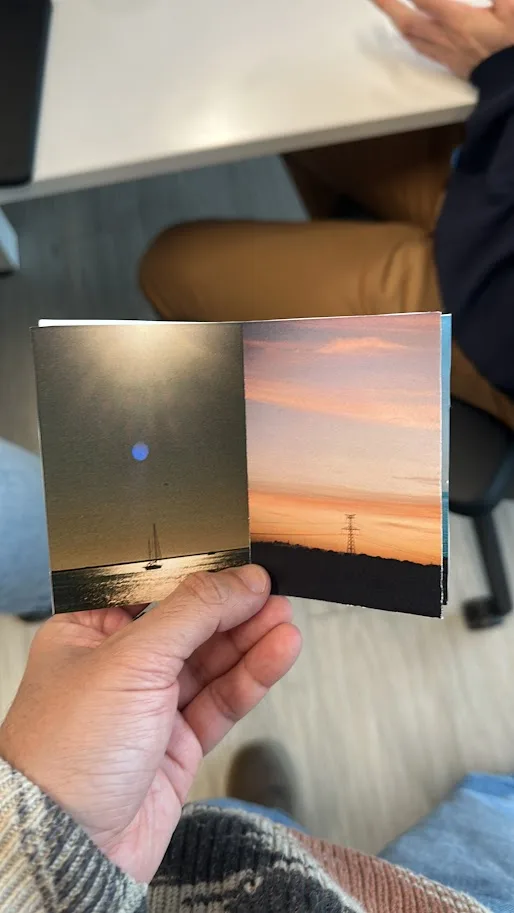
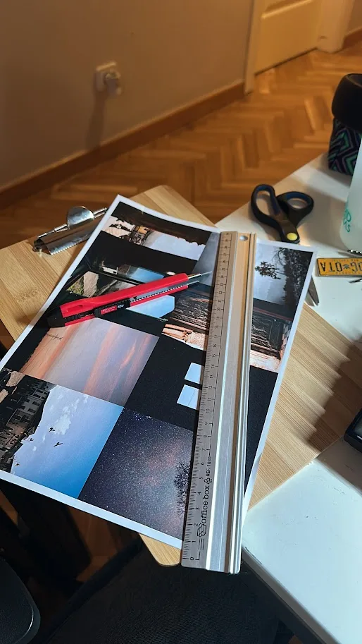
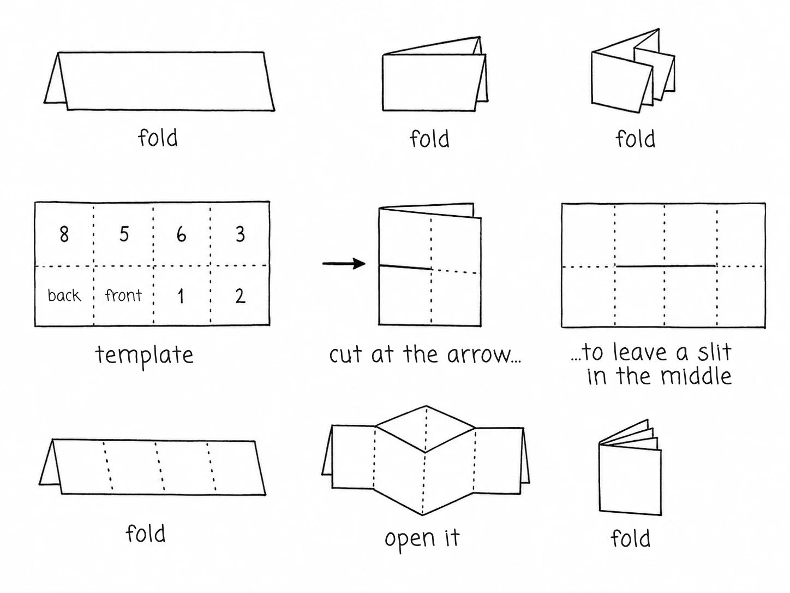

# Fanzines

[](https://github.com/krthr/fanzines.app/actions/workflows/ci.yml)
[](https://nuxt.com)
[](https://vuejs.org)
[](https://nodejs.org)
[](https://workers.cloudflare.com)
[](#license)

> A browser-based editor to make, print and export foldable A4 zines.

Fanzines is a web app for designing an **eight-panel** zine on a single foldable **A4** sheet: you place text and images on each panel, review the whole sheet and export a **PDF ready to print, cut and fold**. Everything happens in the browser; nothing is uploaded to a server.

- **Website:** [fanzines.app/en](https://fanzines.app/en) in English · [fanzines.app](https://fanzines.app) in Spanish
- **Editor:** [fanzines.app/en/editor](https://fanzines.app/en/editor) in English · [fanzines.app/editor](https://fanzines.app/editor) in Spanish
- **Author:** [Wilson Tovar](https://krthr.co) · [Instagram @wilson__tovar](https://www.instagram.com/wilson__tovar/)

## Screenshots

<table>
  <tr>
    <td width="50%" align="center"><br><sub>Unfolded zine</sub></td>
    <td width="50%" align="center"><br><sub>Zine in hand</sub></td>
  </tr>
  <tr>
    <td width="50%" align="center"><br><sub>Worktable</sub></td>
    <td width="50%" align="center"><br><sub>Folding guide</sub></td>
  </tr>
</table>

## Features

- **8-panel editor with A4 imposition.** Front cover, back cover and 6 inner pages, placed automatically on the print grid (4 columns × 2 rows) with the right rotations for folding.
- **Text and images.** Upload photos (one at a time or in batches) by **dragging them onto the canvas, a page thumbnail or the window**, or with the upload button, and type right on the canvas. Every element can be **moved, rotated, scaled, faded, reordered (z-order) and aligned** within its panel.
- **Inline text editing.** Click a text box and type on the canvas.
- **Batch upload with auto-optimization.** When you import several images, they're spread across the free pages and scaled down automatically if their longest side is over 2400 px.
- **Pages in reading order.** The sidebar shows live thumbnails grouped the way they're read (Front cover, 1|2, 3|4, 5|6, Back cover), and the canvas can show the facing page.
- **Sheet review.** Before you download, the Review step shows the whole A4 sheet with all 8 panels and the PDF options.
- **300 DPI PDF export.** The PDF comes out imposed on a landscape A4 sheet, with optional **cut and fold guides** and **safe margins**.
- **Preview guides.** Turn the 5 mm safe margin on the canvas on or off while you design.
- **In Spanish and English.** Colombian Spanish at `/` and `/editor`; US English at `/en` and `/en/editor`. Every page links to its version in the other language, and the zine you're working on is kept when you switch.
- **Optional PostHog analytics.** Only turned on when the API key is set; it captures usage events and errors, with no session recording.
- **SEO ready.** Sitemap, robots, Open Graph/Twitter metadata, `hreflang` per language and `WebApplication` JSON-LD through `@nuxtjs/seo` and `@nuxtjs/i18n`.
- **Accessible and responsive.** Skip link, visible focus, `prefers-reduced-motion` and a mobile layout.

## Tech stack

| Area | Tool |
| --- | --- |
| Framework | [Nuxt 4](https://nuxt.com) · [Vue 3](https://vuejs.org) |
| UI | [@nuxt/ui](https://ui.nuxt.com) v4 · [Tailwind CSS](https://tailwindcss.com) v4 · [Iconify (lucide)](https://iconify.design) |
| Canvas / editor | [Konva](https://konvajs.org) · [vue-konva](https://github.com/konvajs/vue-konva) |
| PDF export | [jsPDF](https://github.com/parallax/jsPDF) |
| Animation | [GSAP](https://gsap.com) + ScrollTrigger |
| Images / fonts | [@nuxt/image](https://image.nuxt.com) · [@nuxt/fonts](https://fonts.nuxt.com) |
| SEO | [@nuxtjs/seo](https://nuxtseo.com) |
| Languages | [@nuxtjs/i18n](https://i18n.nuxtjs.org) |
| Scripts / analytics | [@nuxt/scripts](https://scripts.nuxt.com) · [PostHog](https://posthog.com) |
| Deployment | [Cloudflare Workers](https://workers.cloudflare.com) · [Wrangler](https://developers.cloudflare.com/workers/wrangler/) |

## Requirements

- **Node.js 26** (pinned in [`.nvmrc`](./.nvmrc)). If you use `nvm`:

  ```bash
  nvm use
  ```

## Install and run

```bash
npm ci
npm run dev
```

The dev server starts at **http://localhost:3000**. The editor is at `/editor`.

### Environment variables

PostHog is **optional** and not needed for development. To turn analytics on, copy [`.env.example`](.env.example) to `.env` and set the public key:

```bash
NUXT_PUBLIC_SCRIPTS_POSTHOG_API_KEY=your_public_key
```

Without this variable, analytics stay off.

## Scripts

| Command | Description |
| --- | --- |
| `npm run dev` | Dev server at `http://localhost:3000` |
| `npm run build` | Builds the app for production (output in `.output/`) |
| `npm run generate` | Generates the static site |
| `npm run preview` | Previews the production build locally |
| `npm run typecheck` | Type-checks with `vue-tsc` |
| `npm run analyze` | Analyzes the app bundle without serving it |
| `npm run postinstall` | Prepares Nuxt types (`nuxt prepare`, runs after `npm install`) |

## Project structure

```
fanzines/
├── app/
│   ├── app.vue                     # Root: UApp + WebApplication JSON-LD
│   ├── app.config.ts               # @nuxt/ui theme (colours and toast style)
│   ├── error.vue                   # Error page
│   ├── assets/css/main.css         # Brand tokens (landing, error and editor) and base editor pieces
│   ├── components/
│   │   └── LocaleSwitch.vue        # Link to the same page in the other language
│   ├── components/zine/
│   │   ├── ZineEditor.client.vue   # Editor: top bar, Design and Review modes, mobile layout
│   │   ├── EditorBrand.vue         # Brand and H1, shared with the prerendered fallback
│   │   ├── PagesSidebar.vue        # Pages sidebar: reading spreads or the sheet view
│   │   ├── PageStrip.vue           # Page strip (mobile)
│   │   ├── PageMini.vue            # Page thumbnail
│   │   ├── ZinePageRender.vue      # Live render of one page (thumbnails and facing page)
│   │   ├── PageCanvas.vue          # Konva canvas: active page, facing page and floating toolbar
│   │   ├── DropOverlay.vue         # Notice shown while files are dragged over the editor
│   │   ├── ElementInspector.vue    # Element properties panel
│   │   ├── TextColorPicker.vue     # Text colour: preset swatches and the custom colour picker
│   │   ├── MobileBar.vue           # Action bar (mobile)
│   │   ├── SheetPreview.vue        # Imposed A4 sheet (sidebar and review)
│   │   ├── ReviewPanel.vue         # Review and PDF options
│   │   ├── PdfReadyDialog.vue      # "Your zine is ready" dialog
│   │   ├── FlowSteps.vue           # Design → Review → Print and fold steps
│   │   └── ZineToggle.vue          # Toggle switch
│   ├── composables/
│   │   ├── useZineStore.ts                  # Zine state (useState)
│   │   ├── useZineEditorView.client.ts      # View state: mode, facing page, pages with content
│   │   ├── useZineElementActions.client.ts  # Actions on the selected element
│   │   ├── useZineExport.client.ts          # PDF export and its state
│   │   ├── useZineImageImport.client.ts     # Image import
│   │   ├── usePageTileDrop.client.ts        # Dropping files on a thumbnail
│   │   ├── useZineDragState.client.ts       # Drag state
│   │   ├── useZineAnalytics.client.ts       # PostHog events
│   │   ├── useTrackedZinePageSelection.client.ts
│   │   ├── useZinePageLabels.ts             # Page names in the current language
│   │   └── useLocalizedImage.ts             # Images with text: the current language's version
│   ├── utils/
│   │   ├── zineLayout.ts            # A4 geometry, imposition, reading order and conversion to mm and pt
│   │   ├── renderZine.client.ts     # Renders elements to Konva
│   │   ├── renderPage.client.ts     # Renders one page to a canvas
│   │   ├── renderSheet.client.ts    # Renders the whole sheet to a canvas
│   │   ├── exportPdf.client.ts      # PDF generation with jsPDF
│   │   ├── zineImageCache.ts        # HTML image cache
│   │   └── textLines.ts             # Multi-line titles from a single message
│   ├── types/zine.ts               # Types: PageId, ZineElement, ZineState…
│   ├── plugins/posthog-errors.client.ts
│   └── pages/
│       ├── index.vue               # Landing
│       └── editor.vue              # Editor page and its prerendered fallback
├── i18n/locales/
│   ├── es-CO.json                  # Spanish strings (default language)
│   └── en-US.json                  # English strings
├── public/
│   ├── favicon.ico · favicon.svg
│   ├── _robots.txt
│   └── images/                     # Photos and guides (webp); the ones with text have an -en twin
├── .github/                        # CI, issue and PR templates, Dependabot
├── nuxt.config.ts                  # Modules, SEO, languages, fonts, icons, routeRules
├── wrangler.jsonc                  # Cloudflare Workers config (domains)
├── DESIGN.md                       # Design system: colours, type, components
├── CONTRIBUTING.md                 # Contributor guide
├── .env.example                    # Environment variables (all optional)
├── .nvmrc                          # Node 26
└── package.json
```

## Architecture

### Zine state

State lives in `useState<ZineState>` through [`useZineStore`](app/composables/useZineStore.ts). It holds the selected page, the selected element, the element map and the order on each page. Images are stored as `blob:` URLs and released (`URL.revokeObjectURL`) when they're deleted or the zine is reset.

Anything that only affects how the editor looks (Design or Review mode, single page or spread, the sidebar tab, the PDF dialog) lives separately, in [`useZineEditorView`](app/composables/useZineEditorView.client.ts), and isn't part of the zine. Review is a mode inside `/editor`, not a separate route, because the zine only exists in memory.

### Geometry and imposition

[`zineLayout.ts`](app/utils/zineLayout.ts) defines the A4 format (297 × 210 mm) and maps the 8 pages onto a grid of 4 columns × 2 rows. A panel is 74.25 × 105 mm; state works in page units (`PAGE_W` = 1000) and the interface always shows millimetres (and points for type size). The top panels are rotated 180° so that, after printing on one side, cutting the center line and folding, the zine reads in order:

```
┌─────┬─────┬─────┬─────┐
│  6  │  5  │  4  │  3  │   ← rotated 180°
├─────┼─────┼─────┼─────┤
│Back │Front│  1  │  2  │   ← upright
└─────┴─────┴─────┴─────┘
```

### Rendering

The editor canvas uses **Konva** through `vue-konva`. Thumbnails and the facing page are drawn by [`renderPage.client.ts`](app/utils/renderPage.client.ts), which uses the same nodes as the sheet and the PDF. To export, [`renderSheet.client.ts`](app/utils/renderSheet.client.ts) mounts an offscreen `Stage` with every panel imposed and returns a canvas; [`exportPdf.client.ts`](app/utils/exportPdf.client.ts) embeds it in a landscape A4 PDF with **jsPDF** at 300 DPI, adding the cut/fold guides and the safe margins when they're turned on.

### Languages

The app is in Colombian Spanish (`es-CO`, the default) and US English (`en-US`), with [`@nuxtjs/i18n`](https://i18n.nuxtjs.org). The language is part of the URL: Spanish keeps the original routes (`/`, `/editor`) and English lives under `/en` (`/en`, `/en/editor`).

- **Text.** Everything users read is in [`i18n/locales/es-CO.json`](i18n/locales/es-CO.json) and [`i18n/locales/en-US.json`](i18n/locales/en-US.json), under the same keys. Components use `t('key')`. A message with `|` has a singular and a plural (`"Drop the photo | Drop the {count} photos"`), so a message can't contain a literal bar. A title over several lines is a single message with line breaks (`\n`), split by [`toLines`](app/utils/textLines.ts).
- **Page names.** "Front cover", "Page 1" or "the back cover" come from [`useZinePageLabels`](app/composables/useZinePageLabels.ts), not from constants.
- **Links.** Internal links use `<NuxtLinkLocale>` (or `useLocalePath`) to stay in the current language. [`LocaleSwitch`](app/components/LocaleSwitch.vue) goes to the same page in the other language; in the editor the zine is kept, because its state lives in `useState`.
- **Images with text.** The editor screenshot, the folding guide and the social image have an English twin with an `-en` suffix (`fold-guide.webp` and `fold-guide-en.webp`). [`useLocalizedImage`](app/composables/useLocalizedImage.ts) picks the right one.
- **No redirect based on the browser language.** Pages are prerendered and served before the Worker runs, so a redirect could only happen on the client, after the Spanish page has already painted, and Googlebot (which renders as `en-US`) would end up locked out of the Spanish pages. Search engines pick a version through `hreflang`, and people through the language link.

To add a language: a new file in `i18n/locales/`, its entry in `i18n.locales`, its routes in `routeRules` and `nitro.prerender.routes` in [`nuxt.config.ts`](nuxt.config.ts), and the twin images. `LocaleSwitch` and `useLocalizedImage` assume there are two languages.

### SEO and routes

`@nuxtjs/seo` handles the sitemap, robots and metadata. In [`nuxt.config.ts`](nuxt.config.ts), `routeRules` prerenders `/`, `/editor`, `/en` and `/en/editor`, and `site` sets the canonical URL `https://fanzines.app`. Each page declares its language (`<html lang>`), its canonical URL, `og:locale` and one `hreflang` per language from [`app.vue`](app/app.vue), which also injects the `WebApplication` JSON-LD. There's a single `sitemap.xml`, with the four URLs and their alternates.

### Analytics

Events are only captured when `NUXT_PUBLIC_SCRIPTS_POSTHOG_API_KEY` is set. [`useZineAnalytics.client.ts`](app/composables/useZineAnalytics.client.ts) sends events such as `zine_pdf_export_started` and `zine_images_uploaded`, each with the language (`locale`), and [`posthog-errors.client.ts`](app/plugins/posthog-errors.client.ts) captures unhandled exceptions.

## Deployment

The project is deployed to **Cloudflare Workers** with [`wrangler.jsonc`](wrangler.jsonc) (custom domains `fanzines.app` and `www.fanzines.app`, the `nodejs_compat` flag, observability on).

The production Worker is `fanzines-app`, and **Workers Builds** deploys it on every push to `main` (other branches in this repository upload preview versions; pull requests from forks don't, which is why [CI](.github/workflows/ci.yml) builds the Worker on every pull request). The `name` in `wrangler.jsonc` has to match that name: otherwise a manual `wrangler deploy` would create a second Worker and move the domains to it.

The canonical URL is `https://fanzines.app`. Redirects are set up in the Cloudflare zone, not in code, because prerendered pages and static files are served before the Worker runs:

- **Redirect Rule** (Rules → Redirect Rules): `www.fanzines.app` and `http://fanzines.app` → `https://fanzines.app` + path, 301, keeping the query string, in a single hop.
- **Always Use HTTPS** and **HSTS** (SSL/TLS → Edge Certificates).

Locally, `npm run build` uses the Node preset. To build exactly what Workers Builds deploys (the `cloudflare_module` preset and the Wrangler config Nitro generates, with the `ASSETS` binding), set `WORKERS_CI`:

```bash
WORKERS_CI=1 npm run build
npx wrangler dev      # try the Worker locally
npx wrangler deploy   # manual deploy; usually not needed
```

Without `WORKERS_CI`, `npx wrangler deploy` fails with "Missing entry-point", and passing it the Worker path by hand deploys without the `ASSETS` binding or the flags Nitro adds.

See the [Nuxt deployment docs](https://nuxt.com/docs/getting-started/deployment) for other targets.

## Contributing

Contributions are welcome, in English or Spanish. [`CONTRIBUTING.md`](CONTRIBUTING.md) covers setting up, the code, text and design conventions, how to check a change and how to open a pull request. For big changes, open an issue first.

- [Code of Conduct](CODE_OF_CONDUCT.md)
- [Security policy](SECURITY.md): report security problems privately, not in an issue.

## License

[MIT](./LICENSE) © 2026 [Wilson Tovar](https://krthr.co) · [Instagram @wilson__tovar](https://www.instagram.com/wilson__tovar/)
